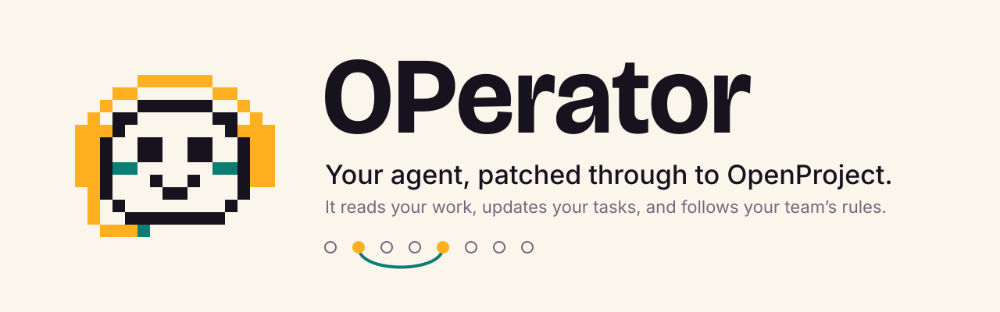

<picture>
  <source media="(prefers-color-scheme: dark)" srcset="docs/brand/assets/hero/readme-hero-dark.svg">
  
</picture>

# OPerator

[](https://www.npmjs.com/package/operator-mcp)
[](./LICENSE)

Your coding agent can read your whole repository and still has to ask *"which
ticket is this?"*. It can't see your OpenProject, so you paste work packages into
the chat by hand, and the house rules (branch names, who closes what) get
restated every session.

OPerator is an MCP server that patches your agent through to your OpenProject
instance. It reads and updates work packages, triages notifications and logs
time, and it follows your workplace's written conventions while doing so.

```
You: what's on my plate?
Agent: 3 work packages assigned to you in Acme:
       #1284  Bug   In progress  Fix login redirect loop
       #1301  Task  New          Migrate invoice export
       #1312  Task  New          Review Q3 access audit
```

## Quickstart

On macOS or Linux (x64 or arm64):

```bash
curl -fsSL https://operator-mcp.pages.dev/install.sh | sh
```

You don't need Node.js or sudo for this. The script downloads one gzipped binary,
checks it against the release's SHA-256, puts it in `~/.local/bin` and starts the
setup wizard. `sh -s -- --no-setup` installs and stops there.
`OPERATOR_VERSION=1.2.0` pins a release and `OPERATOR_INSTALL_DIR` picks another
folder. To update, run the same line again.

**Have Node.js 22 or newer?** You can skip the download, since npm fetches the
package on demand. This is also the way to install on Windows and Alpine:

```bash
npx operator-mcp setup
```

**Or download the binary yourself** from the
[latest release](https://github.com/DanielEsc0911/operator-mcp/releases/latest).
The files are named `operator-mcp-<linux|darwin>-<x64|arm64>.gz`, and
`SHA256SUMS` covers each `.gz`. Unpack the file, make it executable and put it
on your `PATH`. macOS marks browser downloads as quarantined, so clear that flag
once:

```bash
gunzip operator-mcp-darwin-arm64.gz
chmod +x operator-mcp-darwin-arm64
xattr -d com.apple.quarantine operator-mcp-darwin-arm64
./operator-mcp-darwin-arm64 setup
```

## The wizard

`operator-mcp setup` takes about a minute. The installer starts it for you:

1. **Where does your OpenProject live?** Enter the address you log in at,
   for example `https://openproject.acme.com`. Plain `http://` is refused
   unless the host is loopback.
2. **Your API key.** The wizard gives you the direct link,
   `<your-url>/my/access_tokens` (on older instances: *My account → Access
   token*). The key is masked while you type and never leaves your machine.
3. **Line check.** The wizard checks the key against your instance before
   saving anything: `Line's open: Ada Lovelace · 12 projects`.
4. **Default project.** Pick one from a numbered list, type an identifier, or
   choose none.
5. **Agents.** Every agent found on the machine shows up in a pre-ticked
   checklist. Press Enter to register them all.
6. **Doctor.** The same checks `operator-mcp doctor` runs, inline.

Then **restart your agent** and ask it *"what's on my plate?"*. That's all the
setup there is. Run `operator-mcp doctor` (or `npx operator-mcp doctor`) any
time to check the connection.

### Verifying it worked

| Agent | Check |
|---|---|
| Claude Code | `/mcp` lists `openproject` as connected |
| Claude Desktop | *Settings → Developer* shows `openproject` running |
| Codex CLI | `codex mcp list` shows `openproject` |
| Gemini CLI | `/mcp` lists `openproject` |
| Cursor | *Settings → MCP* shows `openproject` enabled |
| opencode | `/mcp` lists `openproject` |

If the tools still aren't there, see [Troubleshooting](#troubleshooting).

## Registering with agents

`setup` does this for you at the end. Run it standalone whenever you install a new
agent, or want to add a second profile:

```bash
npx operator-mcp install          # detect agents, ask which to register
npx operator-mcp install --yes    # register every detected agent, no prompt
```

It detects these, writes the entry, and backs up any file it changes:

| Agent | Where it writes |
|---|---|
| **Claude Code** | delegates to `claude mcp add --scope user` |
| **Claude Desktop** | `~/Library/Application Support/Claude/claude_desktop_config.json` (macOS), `%APPDATA%\Claude\claude_desktop_config.json` (Windows). There is no Linux build, so it isn't offered there |
| **Codex CLI** | `~/.codex/config.toml` |
| **Gemini CLI** | `~/.gemini/settings.json` |
| **Cursor** | `~/.cursor/mcp.json` |
| **opencode** | `~/.config/opencode/opencode.json` |

The installed binary registers itself by its absolute path, which Claude
Desktop needs because it starts servers with a minimal `PATH`. If you
use `npx` instead, Claude Desktop must be able to find Node on its own
`PATH`. When it can't, install the binary or put the absolute path of `npx`
in the entry.

Existing servers in those files are left untouched — only OPerator's own entry is
written.

### Registering by hand

For an agent OPerator doesn't detect, or if you'd rather write the config
yourself. Every MCP client wants the same two facts: run `npx`, with the arguments
`-y operator-mcp` — or, if you installed the binary, run its absolute path
(`~/.local/bin/operator-mcp`, expanded) with no arguments.

<details>
<summary><b>Claude Code</b></summary>

```bash
claude mcp add openproject --scope user -- npx -y operator-mcp
```

Use `--scope project` instead to check the server into a repo for your team (it
lands in `.mcp.json`); `--scope local` limits it to the current project, just for you.
</details>

<details>
<summary><b>Codex CLI</b> — <code>~/.codex/config.toml</code></summary>

```toml
[mcp_servers.openproject]
command = "npx"
args = ["-y", "operator-mcp"]
```
</details>

<details>
<summary><b>Gemini CLI</b> — <code>~/.gemini/settings.json</code></summary>

```json
{
  "mcpServers": {
    "openproject": { "command": "npx", "args": ["-y", "operator-mcp"] }
  }
}
```
</details>

<details>
<summary><b>opencode</b> — <code>~/.config/opencode/opencode.json</code></summary>

```json
{
  "$schema": "https://opencode.ai/config.json",
  "mcp": {
    "openproject": {
      "type": "local",
      "command": ["npx", "-y", "operator-mcp"],
      "enabled": true
    }
  }
}
```
</details>

<details>
<summary><b>Claude Desktop</b>, <b>Cursor</b>, <b>Windsurf</b>, <b>Cline</b>, <b>Zed</b>, and most others</summary>

```json
{
  "mcpServers": {
    "openproject": { "command": "npx", "args": ["-y", "operator-mcp"] }
  }
}
```

This is the common MCP shape. Any client that accepts a stdio server takes it —
check your client's docs for which file it reads.
</details>

<details>
<summary><b>VS Code</b> — <code>.vscode/mcp.json</code></summary>

```json
{
  "servers": {
    "openproject": { "type": "stdio", "command": "npx", "args": ["-y", "operator-mcp"] }
  }
}
```
</details>

Credentials never appear in these files. They live in
`~/.config/operator-mcp/<profile>/config.json`, written with `0600` permissions,
so your MCP config stays safe to check into a repo.

## What your agent can do

| | |
|---|---|
| **Identity** | `whoami` |
| **Discovery** | `list_projects` · `list_users` · `get_work_package` · `search_work_packages` · `my_work` |
| **Tasks** | `create_work_package` · `update_work_package` · `comment_work_package` · `list_activities` · `link_work_packages` |
| **Notifications** | `list_notifications` · `mark_notifications_read` · `watch_work_package` |
| **Time & metadata** | `log_time` · `list_metadata` |
| **Conventions** | `conventions` · `add_convention` · `remove_convention` |
| **Escape hatch** | `api_request` |

The API key is yours, so the server already knows who you are — `my_work` and your
notification feed need no further configuration.

## Your agent can't delete anything. By design.

No tool deletes. OPerator has no `delete_*` tool at all, so an agent cannot
delete a work package because it misread a vague instruction. The generic
`api_request` tool also refuses `DELETE` unless you set
`OPENPROJECT_ALLOW_DELETE=1` in the server's environment, and an agent can't
set that for itself. If you want the agent to report without touching
anything, [read-only mode](#read-only-agents) refuses every write before it
leaves the machine.

## Conventions — teaching your agent how you work

Every profile carries a markdown manual at
`~/.config/operator-mcp/<profile>/conventions.md`. It is handed to the agent at the
start of every session, so your rules apply without anyone restating them:

```markdown
## Git / GitLab
- Branch: `{type}/{wp-id}-{slug}`  →  `bug/1234-fix-login-redirect`
- Commit subject: `[#1234] <imperative summary>`
- MR title must contain `#1234` so GitLab links back to the work package.

## Workflow
- Move to `In progress` only once a branch exists.
- Never close a work package yourself — set `Developed`, QA closes it.
```

`setup` writes a starter file you can edit. Or just tell an agent a rule in
conversation and it records it with `add_convention`, so the rule outlives the
session. Rules are only ever appended; removing one takes an explicit instruction
from you, and the file is backed up first.

**Sharing with a team:** point everyone at one file.

```bash
OPENPROJECT_CONVENTIONS_PATH=/path/to/repo/conventions.md
```

Check that file into your repository and the manual becomes versioned, reviewed in
merge requests, and identical for everyone.

## Two workplaces at once

Each workplace is a profile with its own credentials and its own rules:

```bash
npx operator-mcp setup --profile acme
npx operator-mcp setup --profile personal
```

Each registers under its own server name — `openproject-acme`,
`openproject-personal` — so both can be connected at the same time and your agent
never confuses one instance for the other.

## Read-only agents

Add this to the server's entry in your MCP config:

```json
{ "env": { "OPENPROJECT_READ_ONLY": "1" } }
```

Every create, update, comment, time entry, watch change, and convention edit is
refused before a request leaves the machine. Reads work normally. Useful for an
agent you want reporting on the project but not touching it.

## Configuration

| Variable | Effect |
|---|---|
| `OPENPROJECT_URL` | Instance URL. Overrides the stored profile. |
| `OPENPROJECT_API_KEY` | API key. Overrides the stored profile. |
| `OPENPROJECT_PROFILE` | Profile to load. Same as `--profile`. |
| `OPENPROJECT_DEFAULT_PROJECT` | Project used when a tool's `project` is omitted. |
| `OPENPROJECT_CONVENTIONS_PATH` | Read the manual from somewhere else. |
| `OPENPROJECT_READ_ONLY` | Set to `1` to refuse every write. |
| `OPENPROJECT_ALLOW_DELETE` | Set to `1` to let `api_request` send `DELETE`. Off by default. Environment only. |
| `OPENPROJECT_ALLOW_INSECURE_HTTP` | Set to `1` to allow a plain `http://` URL to a non-loopback host. The API key then travels unencrypted. Environment only. |

Environment variables win over the stored profile, which makes CI easy: set
`OPENPROJECT_URL` and `OPENPROJECT_API_KEY` and skip `setup` entirely.

## Troubleshooting

**The agent doesn't see OpenProject at all.**
Running `setup` alone is not enough on older versions — it saved credentials but
never told your agent the server existed. Run `npx operator-mcp install`, then
restart the agent. Almost every "it can't find my projects" report is this.

**Registered, but the tools still don't appear.**
Restart the agent completely — most clients only read their MCP config at startup.
Then confirm the server starts on its own:

```bash
npx -y operator-mcp
```

It should sit there silently waiting for JSON-RPC on stdin. Press Ctrl+C. Any error
message it prints instead is the real problem.

**"Not configured. Run: npx operator-mcp setup"**
The agent found the server but no credentials for the profile it asked for. If you
registered a `--profile` server, run `setup --profile <name>` for that same profile.

**"API key rejected"**
The token was revoked or mistyped. Generate a new one at **My account → Access
tokens → API** and re-run `setup`.

**"Cannot reach https://…"**
The instance URL is wrong, or it's behind a VPN this machine isn't on. Open the URL
in a browser from the same machine to confirm.

**Node version.** The `npx` path requires Node 22 or newer (`node --version`). The installed binary needs no Node.

## Development

```bash
npm install
npm test          # mocked, never touches a real instance
npm run build
```

Two runtime dependencies. See `CLAUDE.md` for the working rules.

## License

MIT © Daniel Escalona

OPerator is an independent project, not affiliated with OpenProject GmbH.
